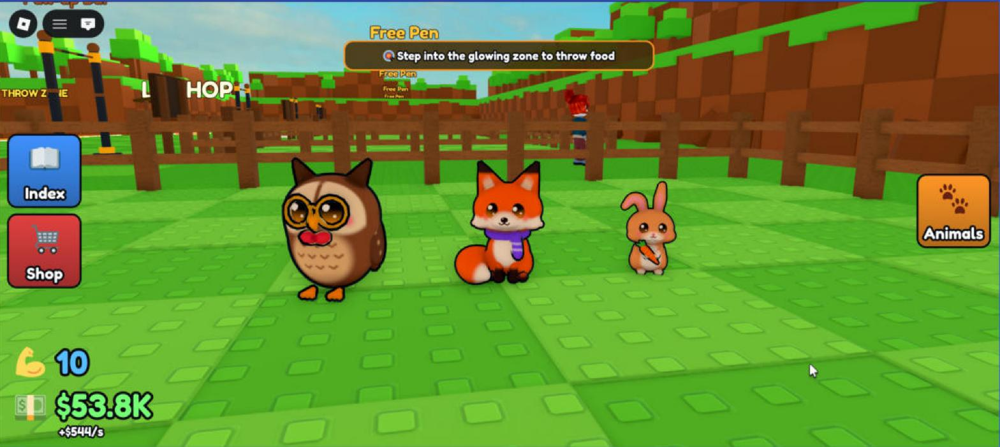

# Snack Toss Safari

A 5-player Roblox collection simulator. Throw food into a canyon, an animal runs to it, you carry it back
to your pen, and it earns money while you train to throw further.



**Video:** available on request.

## Gameplay

- 6 zones, 7 animals each, with rarities and 3 mutations (Gold x2, Giant x3, Rainbow x5)
- Throw meter with a cinematic camera that follows the food and then shows the animal's approach from its eyes
- Pen with 6 to 20 slots that grows with each slot you buy
- Pull-up bar that trains throw power, with an x2 bonus for clicking a pop-up circle
- Food Shop (11 foods), Sell Shop, collection Index, 3 server leaderboards
- Offline income for up to 4 hours

## Tech

- **About 8,000 lines of Luau in 35 modules.** The server has 9 services (Map, Data, Plot, Throw, Training,
  Shop, Leaderboard, Monetization, Character). The client has 8 controllers. All balance values live in
  `ReplicatedStorage/Config`.
- **Multiplayer.** Up to 5 players per server, each with their own plot. Food Shops and upgrade pads are shown
  only to their owner. Players on the throw pad are hidden from the others, on the client only.
- **Saves.** The DataStore uses `UpdateAsync`, autosaves every 90 s and saves again on `BindToClose`.
  Old save formats are migrated when they load.
- **Monetization.** There are 2 game passes and a server-wide x2 Luck developer product, handled through
  `ProcessReceipt`.
- **Animals.** The 7 Forest Edge animals are skinned meshes modelled and rigged in Blender. Code animates
  them by bone name (walk, idle, eat, happy) by setting `Bone.Transform`. The other 35 are built from parts
  in code.
- **Pull-up pose.** Arm IK starts from the avatar's real joint positions and runs in `RunService.Stepped`.
  It works with both Motor6D and AnimationConstraint R15 joints.
- **Build.** `tools/build.py` turns `src/` into a `.rbxlx` place file and embeds `.rbxmx` models.
  The map, models and UI are created by scripts at runtime.

## Layout

```
src/ReplicatedStorage/Config       balance: zones, animals, foods, bars, products
src/ReplicatedStorage/Shared       formulas, model builders, remotes
src/ServerScriptService/Services   server services
src/StarterPlayer/.../Controllers  UI, throw, training, pen, world effects
tools/                             build script, lint
```

## Build

```
python -I tools/build.py
```

Open `SnackTossSafari.rbxlx` in Roblox Studio and press Play. The place looks empty in Edit mode because
everything is built at runtime.

The 3D models (`*.rbxmx`) are not in this repository, so a build from here has no meshes. The code is
here to read.
